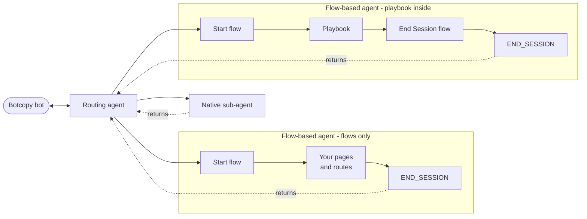

# Patterns

This document is for agents that still integrate Dialogflow. If you are building natively, you can safely ignore this document - the [README](../README.md), [Components](./components.md), and [Cookbook](./cookbook.md) are the whole story.

## Table of Contents

- [Patterns](#patterns)
  - [Table of Contents](#table-of-contents)
  - [Running flows beside native agents](#running-flows-beside-native-agents)
  - [Passing values into and out of a flow](#passing-values-into-and-out-of-a-flow)
  - [Returning cleanly to the routing agent](#returning-cleanly-to-the-routing-agent)
  - [Collecting several values reliably](#collecting-several-values-reliably)

---

## Running flows beside native agents

Google supports keeping your existing Dialogflow flows in service while you build native agents around them. Each flow becomes a [flow-based agent](https://docs.cloud.google.com/gemini-enterprise-cx/cx-agent-studio/flow) sitting beneath a CX Agent Studio routing agent, and control passes to that flow until it reaches `END_SESSION`, at which point the routing agent takes over again.

The arrangement Google recommends puts the routing agent at the top and treats each unit beneath it as self-contained. Three kinds of unit can sit there, and a routing agent can hold any mix of them:



The return paths are the important part. Nothing in either flow names the routing agent as a destination, and nothing in the console shows an arrow back. `END_SESSION` ends the flow's session and the platform hands control back to the routing agent on its own, without you wiring a return path.

Google's guidance for each unit is to [treat flows as encapsulated black boxes, with all requisite information conveyed through explicit input parameters](https://docs.cloud.google.com/gemini-enterprise-cx/cx-agent-studio/flow#flows_as_blackboxes). A [playbook](https://docs.cloud.google.com/dialogflow/cx/docs/concept/playbook), Dialogflow's generative counterpart to a flow that works from instructions and examples instead of pages and routes, may sit inside the box.

Two platform details produce that extra depth, and both concern flows:

- The [flow-based agent import screen](https://docs.cloud.google.com/gemini-enterprise-cx/cx-agent-studio/flow#create_a_flow-based_agent) asks you to provide a flow starting resource, so CX Agent Studio always enters through a flow even when a playbook does the work.

- `END_SESSION` is a page, while pages belong to flows, so a playbook hands control back by routing to a flow that owns one.

Put together, a playbook-backed unit is four hops rather than the two a diagram of it suggests:

```plaintext
CX Agent Studio routing agent
  -> flow-based agent, entered at its start flow
    -> your playbook
      -> a flow that owns an End Session page
        -> END_SESSION, and control returns to the routing agent
```

The entry flow and the closing flow do the same small job. The entry flow's start page carries a single condition route with the condition `true`, targeting the playbook, and the closing flow's start page carries the same kind of route targeting its End Session page.

> [↑ Back to Table of Contents](#table-of-contents)

---

## Passing values into and out of a flow

Google's [Create a flow-based agent](https://docs.cloud.google.com/gemini-enterprise-cx/cx-agent-studio/flow#create_a_flow-based_agent) guide steps 9 and 10 set up the I/O directions. Input variable mapping sends your variables to the flow as session parameters; output variable mapping returns flow session parameters as variables. A value the flow produces and does not map out ends with the flow.

Before a name can appear in either mapping list, the flow has to expose it as a session parameter. Dialogflow creates these at runtime rather than design time, and the reference is explicit that [these parameters are not explicitly defined at design-time](https://docs.cloud.google.com/dialogflow/cx/docs/concept/parameter#session). Google does not document how a name then becomes selectable. What has worked for us is a [parameter preset](https://docs.cloud.google.com/dialogflow/cx/docs/concept/fulfillment#param-preset) on the transition route assigning the parameter back to itself, which gives the name a definition the mapping screen can see.

Wrap each preset value in a [system function](https://docs.cloud.google.com/dialogflow/cx/docs/reference/system-functions) so the reference is evaluated rather than treated as text:

| Preset for | Value |
| :--- | :--- |
| a value carried across unchanged | `$sys.func.IDENTITY($session.params.member_name)` |
| a value that must arrive as a number | `$sys.func.TO_NUMBER($session.params.member_balance)` |

Google documents [`IDENTITY`](https://docs.cloud.google.com/dialogflow/cx/docs/reference/system-functions#func-identity) as returning its argument without the implicit type conversion that can happen with raw parameter references, and recommends it for exactly this field. Where a value has to arrive as a number, [`TO_NUMBER`](https://docs.cloud.google.com/dialogflow/cx/docs/reference/system-functions#func-tonumber) coerces it, which matters because a playbook writes its output parameters through text generation and can hand back text where you expected a figure.

The console adds double quotes around a preset value. That is display formatting and does not stop the expression evaluating.

If a preset value shows up in the conversation as its own literal text, the expression did not evaluate. Dialogflow records why under `SystemFunctionResults` in the `DiagnosticInfo` field of [QueryResult](https://docs.cloud.google.com/dialogflow/cx/docs/reference/rest/v3/QueryResult). Check the [model](../README.md#1-choosing-a-model) on the Dialogflow side too: a weak one writes malformed parameter values, and because they fail at the boundary rather than inside the playbook, the error surfaces a hop away from its cause and reads like a configuration bug.

Inside the flow, a playbook reads a session parameter by declaring an input parameter of the same name. Google's [Playbook parameters](https://docs.cloud.google.com/dialogflow/cx/docs/concept/playbook/parameter#passing-parameters) page describes this for both routine and task playbooks, and recommends showing how each parameter is used in the playbook's instructions and examples, since playbooks have no syntax for injecting values.

> [↑ Back to Table of Contents](#table-of-contents)

---

## Returning cleanly to the routing agent

Give the flow a step that waits for the visitor to speak before handing control back, and make it the point every path returns to. The routing agent then receives a fresh request alongside the returned data, and continues on the visitor's terms. Add a matching rule so it reports and then pauses:

```plaintext
- After a sub-agent returns, report what it produced and then wait for the
  visitor's next message. Only route to that sub-agent again when the visitor
  asks for it again.
```

Word the flow's closing line as a handover rather than a farewell. Its replies join the conversation history the routing agent reads next turn, so "taking you back to the front desk" leaves the routing agent ready to continue. `END_SESSION` closes the flow's session rather than the visitor's.

> [↑ Back to Table of Contents](#table-of-contents)

---

## Collecting several values reliably

An XML `<taskflow>` asks the model to remember what it has collected and decide what to ask next. That works for short exchanges. Google's SCRaPI team documents the [Slot Filling Pattern](https://googlecloudplatform.github.io/cxas-scrapi/latest/patterns/slot-filling/) for the cases where it stops being dependable, noting the platform has no native slot-filling primitive.

The Slot Filling Pattern moves state, control flow, validation, and retries into Python callbacks and leaves the model to handle language. SCRaPI's [side-by-side comparison](https://googlecloudplatform.github.io/cxas-scrapi/latest/patterns/slot-filling/#slot-filling-vs-xml-taskflow) helps judge whether your agent has reached the point where a `<taskflow>` stops being dependable. `botcopy_message` needs no changes to work alongside the pattern: rich payloads are injected through the pattern's [`after_model_callback`](https://googlecloudplatform.github.io/cxas-scrapi/latest/patterns/slot-filling/#4-after_model_callback-payload-injection), so a slot-filling agent can still answer with cards, chips, and forms.

> [↑ Back to Table of Contents](#table-of-contents)
